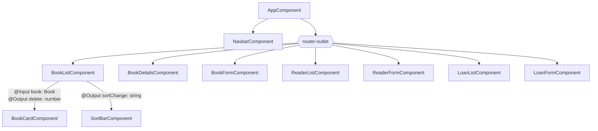

# Biblioteka – projekt Angular

**Temat:** Biblioteka
**Skład grupy:** Grzegorz Kuryś, Łukasz Regliński

Aplikacja do obsługi biblioteki: katalog książek, czytelnicy oraz wypożyczenia i zwroty. Dane trzymane na json-server.

## Klasy i pola

- **Book** – `id: number`, `title: string`, `isbn: string`, `publishedDate: Date`, `pageCount: number`, `genres: string[]`, `author: Author`, `copies: BookCopy[]`
- **Author** – `firstName: string`, `lastName: string`, `birthDate: Date`
- **BookCopy** – `inventoryNumber: string`, `condition: string`, `available: boolean`
- **Reader** – `id: number`, `firstName: string`, `lastName: string`, `email: string`, `birthDate: Date`, `address: Address`
- **Address** – `street: string`, `city: string`, `postalCode: string`
- **Loan** – `id: number`, `bookId: number`, `readerId: number`, `loanDate: Date`, `dueDate: Date`, `returnDate: Date | null`

## Funkcjonalności

- dodawanie, edycja i usuwanie książek
- dodawanie, edycja i usuwanie czytelników
- sortowanie książek (tytuł, data wydania – rosnąco/malejąco)
- wyszukiwanie książek po tytule i autorze
- szczegóły książki (`/books/:id`)
- wypożyczanie i zwrot książki
- lista wypożyczeń po terminie

## Architektura komponentów

| Ścieżka | Komponent |
|---|---|
| `/books` | `BookListComponent` |
| `/books/:id` | `BookDetailsComponent` |
| `/books/new`, `/books/:id/edit` | `BookFormComponent` |
| `/readers` | `ReaderListComponent` |
| `/readers/new`, `/readers/:id/edit` | `ReaderFormComponent` |
| `/loans` | `LoanListComponent` |
| `/loans/new` | `LoanFormComponent` |

Komponenty pobierają dane przez serwisy `BookService`, `ReaderService` i `LoanService`, które łączą się z json-server.
